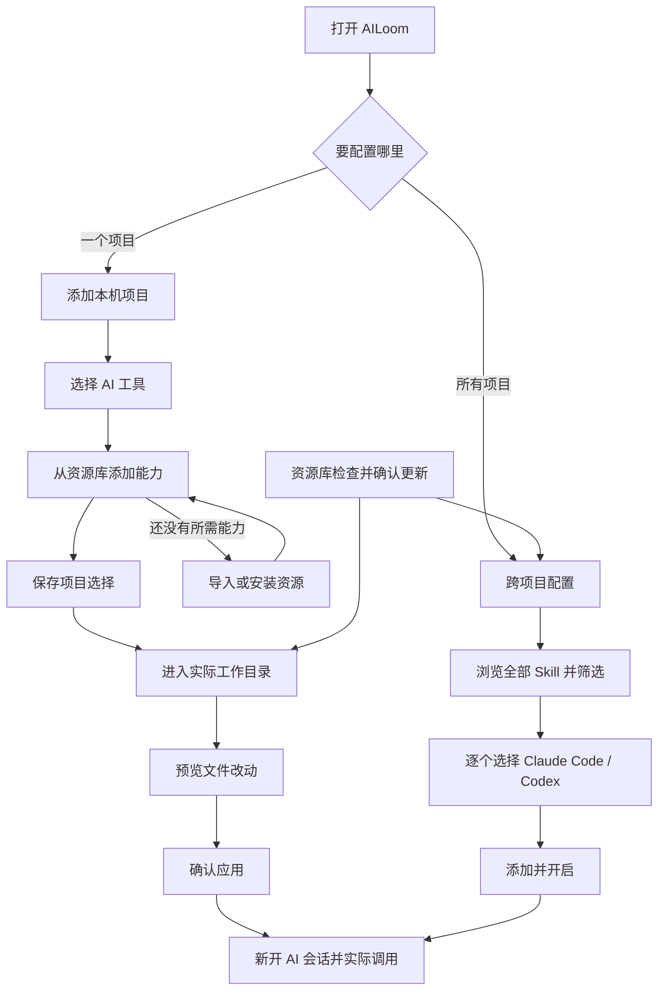

# AILoom 使用流程与场景地图

核对日期：2026-10-07。按当前网页和 CLI 整理；“已有入口”表示代码支持，不等于每种网络、每个 Agent 都已真机通过。验证范围见文末。

## 先按目的选入口

| 我想做什么 | 从这里开始 | 完成到哪里算结束 |
| --- | --- | --- |
| 给一个项目配置 AI | 项目 → 添加项目 / 配置 AI | 在实际工作目录应用，再在 AI 工具中新开会话使用 |
| 让某个 Skill 在所有项目可用 | 资源库 → 跨项目配置 → 添加技能 | 为此 Skill 点亮工具图标，添加并开启 |
| 收集、筛选、更新很多 Skill | 资源库 | 安装或更新入库；需要使用时继续到项目或跨项目配置 |
| 使用公司的团队配置 | 首次用 `ailoom init` 绑定；随后打开项目 | 读取团队配置，叠加个人选择，预览并应用 |
| 搬目录、换机器 | 项目 → 知识库；团队来源单独管理 | 恢复资源与选择，再给本机工作目录应用 |

这里有三个不同的“完成”：**资源入库 → 选用配置保存 → 工具文件应用**。最后还需真实 AI 会话验证加载。项目选择分两步保存和应用；全局“添加并开启”会直接应用该 Skill。

## 1. 第一次给项目配置

1. 运行 `ailoom web`，进入“项目”，添加正在工作的本机文件夹。已经 clone 的 Git 工作目录也在这里选择；这不是填写远程业务仓库 URL 的 clone 表单。
2. 名称自动填写，分类可选。知识库默认位置自动提供；有恢复配置时改走恢复预览。
3. 选择要用的 AI 工具。添加能力时列出整个资源库，可以搜索名称、用途和来源；缺资源时可在弹窗内导入，规则和子代理也可直接新建。
4. Git 项目的“整个项目”保存共用选择；进入某个分支工作目录再应用。普通文件夹项目直接在该目录预览应用。
5. 确认预览中的实际路径和冲突，应用后新开 AI 会话。需要撤销文件变化时去“操作记录”。

| 场景 | 连续操作 | 结果 / 边界 |
| --- | --- | --- |
| 空资源库 | 添加项目 → 添加能力 → 导入资源 → 返回选择弹窗 → 添加 → 应用 | 导入后仍需选用；取消选择不部署 |
| 已有大量资源 | 添加能力 → 搜索用途 / 查看来源分组 → 勾选 → 添加 | 不要求记住 Skill 名字，不默认全选 |
| 公司已有 AGENTS.md 等 | 添加项目 → 保存个人说明或能力 → 预览 | 已跟踪文件有保护；冲突不等于成功应用 |
| 原本就有 AI 配置 | 目录页“本地已有” → 保持、导入副本或明确处理 | 原文件、个人副本、AILoom 托管产物各有所有权 |
| 想换 Agent | 更改 AI 工具 → 预览 → 应用 | 适配能力以矩阵为准；需要扩展的能力另有加载条件 |
| 同名、同路径或本地后改 | 预览显示冲突 → 核对文件 → 重新预览 | 保留用户修改；不靠反复点应用解决 |

## 2. 获取和管理资源

| 来源 | 网页入口 | 如何保存、继续使用 |
| --- | --- | --- |
| 普通 Git 仓库，一个或多个 Skill | 资源库 → 安装 Skill → 扫描仓库 | 枚举 `SKILL.md`，勾选所需项安装到资源库；不要求 `ailoom.toml` |
| 同仓库还有未安装的 Skill | 仓库分组 → 安装其他 Skill | 已安装项标记出来，只补装需要的项 |
| Git 合集，包括 Skill / MCP 等 | 资源库 → 导入 → GitHub / GitLab / 其他 Git → 预览 → 确认 | 普通 Skill 仓库也可作为合集；混合类型按 `ailoom.toml` 识别。确认来源版本后按项选用 |
| 本机一个 Skill | 导入 → 本地 Skill 文件夹 | 选择包含 `SKILL.md` 的文件夹，导入个人副本。修改原目录不等于已更新副本 |
| skills.sh 上的单项 | 导入 → skills.sh | 发现入口解析为资源，确认入库；继续到项目或全局选用 |
| CC Switch 已安装的 Skill | 迁移已有资源 → 从 CC Switch 迁移 | 扫描、筛选、确认导入；导入不代表已解除旧工具的部署 |
| 自己写规则或子代理 | 资源库“新建”，或项目能力弹窗内新建 | 保存到资源库，再选择项目使用 |
| AILoom 团队资源源 | 首次 CLI 绑定；项目设置 → 基本信息 → 团队资源来源 | 按逻辑项目、角色读取团队配置；根目录要求 `ailoom.toml` |

多资源日常路径：**左栏选择仓库 / 合集 → 可用时继续筛选合集目录 → 搜索用途、选择类型 → 安装或更新**。检查按钮会随当前筛选改变范围；合集更新仍按整个确认版本进行，不能把筛选结果误认为部分更新该仓库。

普通 Git Skill、Git 合集、团队资源源都能使用 Git，含义不同：前两种是资源库的来源；团队源还决定项目 / 角色的团队配置。不是所有 Git 仓库都需要 `ailoom.toml`。

## 3. 只给部分工具全局开启

无需先添加项目：**资源库 → 跨项目配置 → 添加技能 → 浏览全部候选 → 仓库过滤 / 搜索 → 点亮此 Skill 的工具图标 → 添加并开启**。

| 场景 | 接下来怎么做 | 结果 |
| --- | --- | --- |
| 只给 Claude Code | 此 Skill 只点亮 Claude Code 图标 | 应用到 Claude 全局 Skill 目录 |
| 只给 Codex | 此 Skill 只点亮 Codex 图标 | 应用到共享 `.agents/skills` 目录；其他会读取此目录的 Agent 也可能可见 |
| 同时给两个工具 | 点亮两个图标 | 此 Skill 的工具选择独立保存 |
| 改为另一个工具 | 在已添加行切换图标 | 直接应用该 Skill 的目录变化 |
| 不想全局使用 | 关闭最后一个图标，或移除 | 移除全局选择和托管部署，资源库副本保留 |
| 同名条目由 CC Switch 等安装 | 查看同名冲突 → 明确选择替换 | 原条目归档；替换后可还原原有技能 |
| 应用失败或只开启一部分 | 核对行状态与错误 → 处理来源 / 目录 / 冲突 → 应用待处理项 | 不把选择保存冒充全部部署成功 |
| 项目也选了同一个资源 | 项目显示“已全局启用”，预览项目文件变化 | 已实际全局部署时去重；同名的不同资源不能据名字推定相同 |

**全局关闭后，需要该 Skill 的项目继续预览并应用**，才能按项目选择补回目录文件。现有 AI 会话可能仍缓存旧能力，需新开会话核对。

## 4. 多分支和子目录

| 场景 | 使用路径 | 应用范围 |
| --- | --- | --- |
| 所有 Worktree 共用能力 | 整个项目保存选择 → 逐个工作目录预览应用 | 共用选择；不会一次自动写完所有 Worktree |
| 某个分支不同 | 选择工作目录 → 设置本层选择 → 预览应用 | 当前工作目录覆盖项目默认值 |
| 项目内某个子目录特殊 | 添加子目录环境 → 选择已有子文件夹 → 设置 / 应用 | 只管理明确添加的子目录，不默认扫描启用所有文件夹 |
| 子目录跟随上级 | 保持“继承上级” | 上级选择沿配置层级生效 |
| 子目录独立 | 改为独立选择 → 重新选能力 → 应用 | 不继续混入上级能力 |
| 撤掉本层覆盖 | 能力详情 → 恢复上级选择 → 应用 | 回到上级结果，未必等于启用 |
| 新 Worktree 或目录消失 | 刷新分支目录 / 读取目录状态 | 缺失目录不创建、不应用；出现后再配置或恢复 |

名称、分类、项目说明、知识库位置是项目共享设置。**团队来源卡片明确显示所绑定的工作目录**，不能把它理解成替所有 Worktree 自动更换来源。

## 5. 更新、编辑和换来源

| 变化 | 连续流程 | 不要漏掉的下一步 |
| --- | --- | --- |
| Git Skill 有新版 | 检查更新 → 查看候选 → 确认更新资源库 | 到项目预览应用；全局用户到跨项目配置刷新并应用待处理项 |
| Git 合集有新版 | 检查来源 → 确认整个合集版本 | 未选资源不自动启用，未应用工作目录保持其部署状态 |
| 批量更新部分失败 | 查看成功与失败 → 失败项重新检查 | 成功部分已保存；不要假设整体回滚 |
| 编辑个人副本 | 编辑 → 保存 | 保存和项目应用是不同动作；Git 更新遇到本地修改有冲突保护 |
| 本地开发后来配了 Git | 来源详情 → 变更来源 → 检测 Git / 选择 remote → 预览 → 保存 | 选跟随本地开发还是远程版本，保留资源身份与现有引用 |
| 仓库改名或换 URL | 变更来源 → 预览关系 → 确认同一来源或替换 | 不能只凭相同 commit 或名字判断是同一仓库；版本升级仍需确认 |
| GitHub SSH 身份别名不同 | 使用本机连接地址；高级项提供明确的 HostName / 仓库地址映射 | 连接地址与可移植仓库身份分开。当前不自动读取复杂 SSH 配置 |
| 健康的团队源也想换路径 | 项目设置 → 基本信息 → 团队资源来源 → 修改来源 | 原选择保留；连接后返回工作目录预览应用 |
| 团队资源从 Git 获取 | 修改来源 → 从 Git 获取 → 填 SSH / HTTPS | 下载目录默认提供并自动创建；可更改，后续沿用本机设置 |
| 团队资源用已克隆目录 | 修改来源 → 使用已有文件夹 → 选择根目录 | 直接读取本机内容；不把它当成远程 URL 再 clone |
| 想更新团队源锁定版本 | `ailoom init --refresh` 后到目录预览应用；CLI 也可 `ailoom sync --refresh` | 普通资源库“检查全部更新”不等于更新项目主团队源 |
| 使用团队 Hook 自动同步 | 安装 Hook 后，Claude 会话开始 / 输入触发按间隔刷新同步 | 这是单独的团队后台链路，不代表个人合集和全局 Skill 也会自动升级；盘上更新后仍需核对宿主加载 |

团队源换到另一个仓库时，已有逻辑项目、角色仍需匹配。校验失败保留原绑定、已保存选择和已部署文件。修改来源不会自动删除旧下载目录，也不会替用户提交、推送本地开发改动。

## 6. 移除、恢复及出错

| 场景 | 下一步 | 保留什么 |
| --- | --- | --- |
| 项目不用某能力 | 移除选择 → 预览 → 应用 | 资源库仍保留，其他项目继续使用 |
| 删除个人副本 | 先处理使用引用 → 删除确认 | 移入 `library-archive`；目前网页没有一键恢复，需从归档重新导入 |
| 移除合集 | 管理来源 → 预览引用 → 移除 | 有启用引用时阻止；移除登记不清空实体与历史缓存 |
| 替换全局已有条目后反悔 | 跨项目配置 → 原有技能备份 → 还原 | 恢复原条目，保留冲突时的后续用户变化 |
| 项目应用后反悔 | 操作记录 → 选中成功应用 → 撤销 | 撤销文件，不回滚当前选用配置；下次应用可能再次生成 |
| 应用中断 | 原预览中恢复入口 / `personal --action recover` → 重新预览 | 有恢复记录；后来修改过的文件受到保护 |
| 预览过期、另一页面修改 | 重新读取 / 重新预览 | 旧预览不强行写入 |
| 主团队目录搬走 | 错误页“修改来源” → 选新路径或 Git → 连接 → 重新读取 | 已部署文件和原选择保留 |
| 团队 Git 首次 clone 失败 | 查看具体网络 / SSH / 仓库错误，保留输入重试 | 不要求先填本地 clone 目录；默认下载位置自动提供 |
| 普通来源离线 | 读已确认的资源；更新检查错误单独展示 | 离线不能保证首次获取和更新成功 |
| 某资源定义损坏 | 资源库问题条目 → 打开修复 / 删除 | 其他可读资源继续可用；问题条目已部署产物保留 |
| 服务重启后旧页面失效 | 刷新页面 | 重新建立页面连接，未确认的操作需核对结果 |

“恢复”有四个对象：**同步中断的文件、一次应用的文件、被替换的原生条目、项目知识库里的配置**。它们不能互相代替。删除来源也不是释放全部磁盘缓存，目前没有面向用户的安全缓存 GC。

## 7. 知识库和换机器

正常链路：**添加项目时确定知识库 → 日常保存经验和选用配置 → 保存恢复配置 → 分别同步业务项目与知识库 → 新设备添加项目 → 预览恢复 → 再预览应用工具文件**。

| 场景 | 路径 / 选择 |
| --- | --- |
| 留在当前机器 | 使用默认保存目录；经验保存和检索可用，默认不代表远程同步已配置 |
| 更改知识库目录 | 项目 → 知识库 → 新位置 → 预览迁移 → 确认；原位置保留 |
| 知识库就在项目里 | 项目声明记录相对路径，换目录后核对知识库身份 |
| 独立 Git 知识库 | 先配置远端同步；新机器选择已克隆目录或从 Git 克隆到新目录 |
| 外部普通文件夹 | 自己同步文件夹到新机器，再关联正确知识库 |
| 多 Worktree / 子目录 | 共用项目知识库，恢复已有的配置；未出现的 Worktree 保留待恢复状态 |
| 零散经验需要整理 | 项目 → 知识库 → 选择本机 AI CLI → 开始整理；保留原文并保存可检索的仓库维护建议 |
| 新机器有不同配置或知识库 ID 不符 | 停在冲突或校验错误；先核对，不能直接覆盖 |
| Git 提交 / 推送冲突 | 显式处理 Git 同步冲突；本地经验仍保留 |

源缓存只是下载内容，**不能代替知识库的可迁移配置**。操作历史、机器凭据和宿主插件安装状态不会因配置恢复自动复制。细节见 [项目与知识库恢复](KNOWLEDGE-PORTABILITY.md)。

## 8. CLI 功能放回使用链路

以下覆盖当前顶层命令及动作入口。用于定位用途，不表示本轮执行了每条命令的成功业务流程。参数以 `<命令> --help` 为准。

| 使用阶段 | CLI 命令 / 动作 | 网页关系 |
| --- | --- | --- |
| 查看版本与入口 | `version`、`help`、`--help` | 服务菜单显示版本与可执行文件 |
| 打开、维护网页 | `web`；`service start / stop / restart / status / enable / disable` | 日常复用同一后台；关闭自启动与停止当前服务分开 |
| 开发调试服务 | 隐藏命令 `console`；`service run` | 前台进程用于开发 / 服务管理器，不应每次手工开一个常驻进程 |
| 建立团队资源库 | `source` | 生成 `ailoom.toml` 和资源骨架；首次创建暂无网页完整流程 |
| 团队绑定与部署 | `init`、`status`、`plan`、`sync`、`sync --recover / --refresh` | 已绑定后可在项目管理；首次项目 / 角色绑定仍以 CLI 为入口 |
| 个人资源库 | `library init / import / import-git / import-entry / list / sources / check-update / update / delete / recover` | 对应导入、更新、删除；`recover` 是更新事务恢复，不是恢复已删副本 |
| Git 合集 | `collection list / preview / apply / check / remove` | 管理来源、确认版本，和项目部署分开 |
| 项目个人选择 | `personal effective / select / instructions / plan / sync / recover / deploy-status / undo / scan-skills / migrate-nongit` | 对应目录配置、说明、预览应用、恢复和普通文件夹迁移 |
| 全局 Skill | `global status / select / plan / sync / recover / takeover / restore` | 对应逐 Skill 工具选择、应用、同名替换及还原 |
| 知识库位置与迁移 | `knowledge status / init / checkpoint / clone / recover / move / configure / sync` | 网页提供位置与恢复；配置远端和显式同步主要在 CLI |
| 知识保存和维护 | `knowledge save / recall / feedback / maintenance / promote / archive / restore`；`recall` | 网页可调用本机 AI CLI 手动整理经验与维护建议；反馈、归档等高级维护以 CLI / Agent 调用为主 |
| 知识输入 | `import`；`pr --action draft`；`contribute` | `import` 顶层导入知识文档，和 `library import` 导入 Skill 不同 |
| 团队资源贡献 | `push`、`contribute-self`；`migrate` | 资源贡献与独立源迁移；可能提交 / 推送 Git，不是普通应用配置 |
| 观测和统计 | `hook`；`hooks install / remove / exec`；`session metrics / summary / ingest`；`dashboard`；`report push / retry / digest / status` | 高级 CLI 链路；`dashboard` 是独立观测服务，不是 `web` |
| 团队依赖与事实索引 | `members list / projects / register / remove`；`packages check / install`；`code build / query` | 高级 CLI 入口，当前无对应日常网页闭环 |
| 诊断与退出 | `doctor`、`diagnose`、`data rotate / export / cleanup`、`uninstall` | 诊断、留存清理、托管卸载；不等于删除源仓库 |

开发者本地验收：`npm --prefix packaging/npm run install:local` → 用 `ailoom-test web`。日常发行版入口是 `ailoom web`。确认网页服务的版本与实际可执行文件；npm 显示的最新版本不能证明当前服务已运行新二进制。详见 [本地安装](../../packaging/npm/README.md)。

## 本轮修正与仍待补齐的入口

已修正：

- 健康状态也能在项目设置修改团队来源，显示所属工作目录和 Git 下载目录；保留异常页的快速入口。
- 资源更新提示同时指向项目和跨项目配置。
- 删除个人副本不再暗示存在网页归档恢复按钮。
- 快速上手及生命周期说明采用当前页面名称和三步帮助入口。

还缺少完整网页闭环，不能作为已经完成的功能介绍：

| 优先级 | 断点 | 现有可用路径 / 建议补齐 |
| --- | --- | --- |
| P1 | 第一次绑定团队源需要 CLI 项目 / 角色参数 | `ailoom init`；后续可增加首次绑定表单并列出可选项目与角色 |
| P1 | 主团队源升级没有独立、明确的网页检查更新动作 | `init --refresh` 后预览应用；应与资源库来源升级区分并提供清晰入口 |
| P1 | 知识库远端配置和同步主要靠 CLI | `knowledge configure / sync`；知识库位置不应让用户误以为已开启多端同步 |
| P2 | 删除个人副本后没有网页归档恢复入口 | 从归档重新导入；后续可增加可浏览的归档列表 |
| P2 | 资源“使用项目”查询只列项目，没有全局使用位置 | 去跨项目配置核对；可合并为完整“使用位置”查询 |
| P2 | SSH Host 别名需要明确映射，不能自动覆盖复杂配置 | 现有来源高级项填写脱敏映射；未经确认的身份不能自动合并 |
| P2 | 失联项目、普通文件夹后配 Git 的迁移主要靠 CLI / 恢复入口 | 先恢复目录或用 `personal migrate-nongit`；缺少统一的项目重新定位入口 |

## 本轮实际验证范围

- 连续浏览器操作使用隔离项目、隔离全局目录和本地 Git 仓库：添加项目 → 扫描两项 Skill → 只安装一项 → 查看未安装项 → 项目选用 / 预览 / 应用 → 操作记录 → 单工具全局开启 → 全局关闭 → 健康团队来源修改。核对了实际项目文件、未选项未部署、全局移除后资源副本保留和团队声明。
- 对应自动化：`console_onboarding`、`console_e2e`、`global_skill_apply`、`collections`、`source_rebinding`、`knowledge_location`、`knowledge_portable`、`cli_actions`；54 项通过。覆盖资源更新及引用保护、分层配置、来源关系、知识库搬迁和恢复。前端组件状态测试 15 项通过。
- 另跑了服务复用检查 `cli_is_independent_and_web_reuses_the_detached_process`，确认普通 CLI 不需要网页后台，重复打开网页复用同一服务。
- `cli_actions` 验证 help 中动作能被分派，缺参数 / 未绑定也可能返回业务错误；它不是“每条 CLI 已完成真实业务”的证明。
- 上述本地 Git 测试没有访问 GitHub / GitLab 真实账户，没有替用户运行贡献推送、安装团队依赖或统计上报。真实认证、Agent 新会话加载和额外宿主扩展需要独立环境验收。
- 本轮没有重新要求盲测 subagent，也没有批量截图。浏览器和文件结果保存在工作区 `.scratch/user-journeys-2026-10-07/`。
